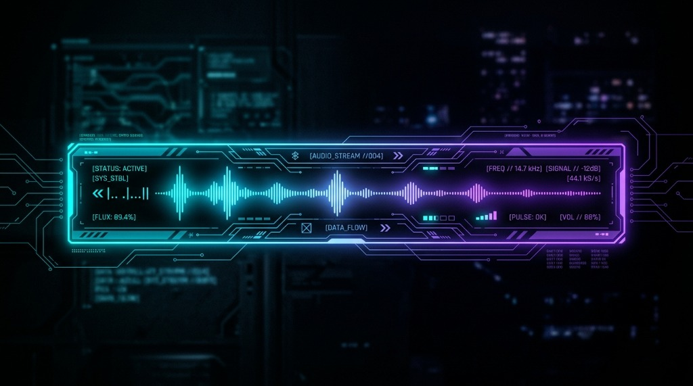
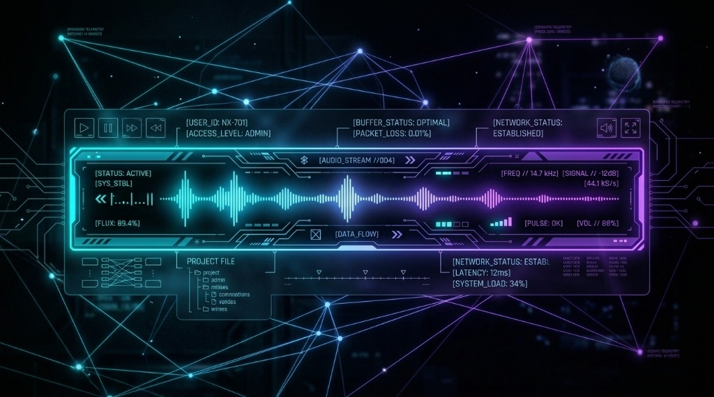

<div align="center">

# Hey There Bud 👋


<p align="center">
  <b>🚀 Full-Stack Developer & AI Systems Engineer | 🎓 B.Tech in AI & Data Science | 🌐 Open-Source Enthusiast</b>
</p>

[](https://github.com/aryantakawane)
[](https://linkedin.com/in/aryantakawane-813442419)
[](https://aryantakawane.vercel.app)
[](mailto:aryantakawane100@gmail.com)
[](https://github.com/aryantakawane)

<br/>


</div>

<p align="center">
  
</p>

## ⚡ Who am I?

I'm **Aryan Takawane**, a full-stack engineer and AI specialist from **Pune, India**. From responsive frontend experiences to robust backend architectures and applied AI (LLMs, RAG pipelines, LangChain), I engineer complete web systems that scale effortlessly.

```javascript
// ✦ developer.config.js — neural runtime profile
const engineer = {
  name:        "Aryan Takawane",
  location:    "Pune, Maharashtra, India 🇮🇳",
  degree:      "B.Tech in Artificial Intelligence & Data Science",
  role:        "Full-Stack Developer & AI Systems Engineer",
  
  stack: {
    core:       ["JavaScript (ES6+)", "Python", "PHP", "TypeScript", "SQL"],
    frontend:   ["React.js", "Next.js", "Tailwind CSS", "Gutenberg"],
    backend:    ["Node.js", "Express.js", "FastAPI", "Django", "REST APIs"],
    ai_ml:      ["LLMs", "RAG Pipelines", "LangChain / LangGraph", "AI Agents", "NLP"],
    databases:  ["PostgreSQL", "MongoDB", "MySQL", "Supabase", "Redis"],
    devops:     ["AWS", "Docker", "Git / GitHub Actions", "CI/CD Pipelines"]
  },

  philosophy:   "I don't just build pages — I engineer reliable, high-performance web systems.",
  uptime:       "99.99% curiosity ☕"
};

export default engineer;
```

---

## 🧠 Neural & Cognitive Systems

<p align="center">
  
</p>

- 🧬 **Vector Embeddings & Semantic Search:** Designing high-accuracy RAG architectures with pgvector and Pinecone.
- 🤖 **Autonomous Tool-Calling Agents:** Engineering goal-driven agents using LangChain, LangGraph, and local/cloud LLMs.
- ⚡ **Full-Stack AI Integration:** Embedding real-time intelligence directly into production web dashboards.

---

## 🛠️ Tech Arsenal

<div align="center">

### 💻 Languages & Frameworks
<p align="center">
  
  
  
  
  
  
  
  
</p>

### 🤖 Applied AI & Intelligence
<p align="center">
  
  
  
  
  
</p>

### ☁️ Databases & Cloud DevOps
<p align="center">
  
  
  
  
  
  
</p>

</div>

---

## 🚀 Key Production & Featured Projects

| Project | Focus & Highlights | Stack |
| :--- | :--- | :--- |
| **Shreenivas Platform** *(Production)* | Solely built & deployed an end-to-end spiritual service platform with user authentication, appointment scheduling, payment handling, and admin control panels. | React, Node.js, REST APIs, Cloud Deployment |
| **D2C E-Commerce Engine** | Full-scale e-commerce platform built from scratch with inventory control, cart & wishlist, secure checkout, reviews, and admin analytics dashboard. | Full-Stack Architecture, Node.js, MongoDB |
| **[wp-decoupled](https://github.com/aryantakawane/wp-decoupled)** | Modern decoupled / headless WordPress architecture consuming custom REST APIs with high-performance React frontends. | React, WordPress REST API, JavaScript |
| **[wp-rest-playground](https://github.com/aryantakawane/wp-rest-playground)** | Developer testing ground for custom WordPress REST endpoints, Custom Post Types (CPTs), taxonomy queries, and security nonces. | PHP, WordPress Plugin API |
| **[todo-app-fullstack](https://github.com/aryantakawane/todo-app-fullstack)** | Production-grade web app featuring JWT authentication, state management, and optimized database queries. | Node.js, Express, React, MongoDB |
| **[movie-search-app](https://github.com/aryantakawane/movie-search-app)** | Dynamic search application with real-time API integrations, responsive UX, and client-side caching. | React, External REST APIs, CSS3 |

---

<p align="center">
  
</p>

## 🎯 Active Directives & Standards

- 🧠 **Applied AI in Web Platforms:** Integrating RAG document chat, LLM tool-calling agents, and semantic vector search into practical web applications.
- ⚡ **Performance & Core Web Vitals:** Minimizing layout shifts, server-side response times, and bundle sizes for lightning-fast user interactions.
- 🛡️ **Enterprise Security Standards:** Enforcing OWASP principles, strict data sanitization, parameterized queries, and secure session management.
- ♿ **Inclusive Accessibility:** Building component libraries compliant with **WCAG 2.1 AA** standards.

---

## 📊 GitHub Analytics

<div align="center">


<br/><br/>


</div>

---

<div align="center">

📫 **Let's connect & collaborate:** [LinkedIn](https://linkedin.com/in/aryantakawane-813442419) • [Email](mailto:aryantakawane100@gmail.com) • [Portfolio](https://aryantakawane.vercel.app)

*"Code is poetry written for machines, but engineered for humans."*

⭐ **If you find my projects helpful, feel free to drop a star!**

</div>
